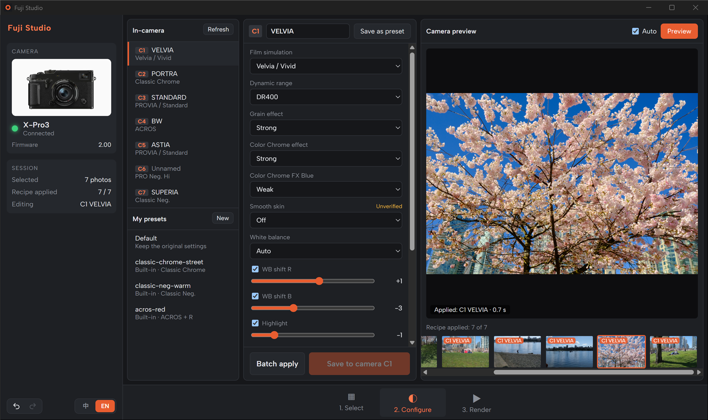
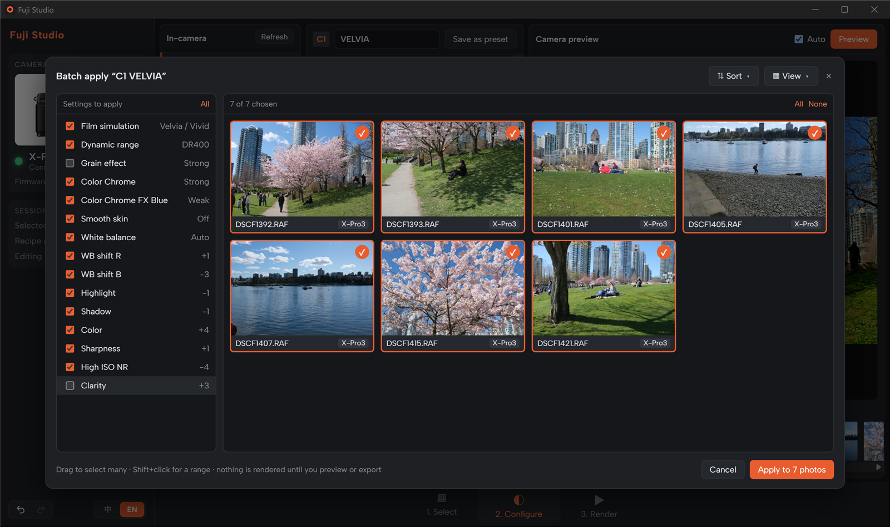
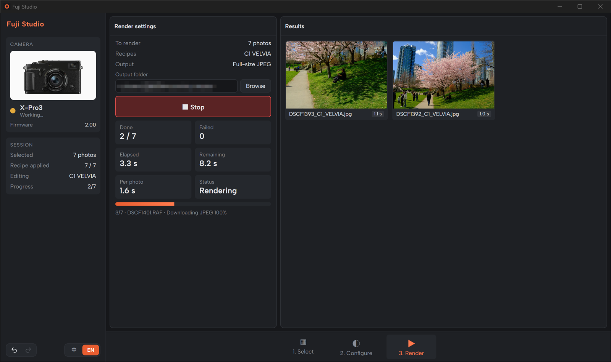

<div align="center">


# Fuji Studio

**Render Fujifilm RAW files with your camera's own engine, fast.**

[](https://github.com/ELjagi623/fuji-studio/releases)


[Features](#features) · [Getting started](#getting-started) · [Usage](#usage) · [Build from source](#build-from-source) · [中文](README.zh-CN.md)



</div>

Fuji Studio sends your RAF files to a Fujifilm camera over USB, lets the camera's own processor apply the film simulation and recipe, and brings the JPEG straight back to your PC. The result is the same image the camera would produce, at about **one second per full-size photo**, a fast alternative to X RAW Studio.

## Features

- **Local library**: browse folders in a built-in tree, Explorer-style views and sorting, and drag across thumbnails to select many at once.
- **All your recipes**: built-in film simulations, your own presets, and the camera's custom settings **C1–C7**, which you can also edit and save back to the camera.
- **Batch apply**: apply a recipe, or only some of its settings, to the photos you choose, then combine several recipes across one batch.
- **Live camera preview**: see the camera's actual rendering while you tweak settings; hold the image to compare with the original.
- **Batch render**: full-size JPEGs with progress, elapsed and remaining time, and each result shown as it finishes.
- **Helpful details**: guides you if the camera is in the wrong USB mode, supports undo/redo (<kbd>Ctrl</kbd>+<kbd>Z</kbd>), and switches between English and 中文.

<table>
  <tr>
    <td></td>
    <td></td>
  </tr>
  <tr>
    <td align="center"><em>Batch apply a recipe to chosen photos</em></td>
    <td align="center"><em>Rendering in the camera</em></td>
  </tr>
</table>

## Getting started

### 1. Install

Download the latest version from [Releases](https://github.com/ELjagi623/fuji-studio/releases):

- `FujiStudio_x.y.z_x64-setup.exe`: installer
- `FujiStudio_x.y.z_x64_portable.exe`: single file, no install needed

Windows 10/11 (64-bit) is required. The WebView2 runtime ships with Windows 11 and is installed automatically if it's missing.

### 2. Set up the camera

1. Unplug the USB cable.
2. On the camera, open **MENU → SET UP → CONNECTION SETTING → PC CONNECTION MODE**.
3. Choose **USB RAW CONV./BACKUP RESTORE**.
4. Plug the cable back in. The sidebar turns green once the camera is ready.

> [!IMPORTANT]
> The camera can only convert RAF files shot on **the same model**. Photos from other bodies are marked and skipped.

> [!TIP]
> If the camera is in the wrong mode, Fuji Studio shows these steps automatically and re-checks with one click.

## Usage

1. **Select**: pick a folder on the left and select photos (click, drag across, or <kbd>Shift</kbd>+click). Selections add up across folders.
2. **Configure**: choose a recipe (in-camera C1–C7, built-in, or your own), adjust it with the live preview, then click **Batch apply** to assign it to photos. Only photos with a recipe are rendered.
3. **Render**: choose an output folder and click **Start render**.

> [!NOTE]
> Saving to the camera's C1–C7 asks for confirmation first, and backs up all seven slots before the first write of each session.

## Supported cameras

Developed and tested on the **X-Pro3** (firmware 2.00). The same protocol is used by all bodies on Fujifilm's [X RAW STUDIO compatibility list](https://www.fujifilm-x.com/support/compatibility/software/x-raw-studio/) (X-H2S, X-T5, X-S20, X100VI, GFX100 II and others), so they should work but haven't been tested yet.

## Build from source

Prerequisites: [Rust](https://rustup.rs/), [Node.js](https://nodejs.org/) 20+, and the [Tauri prerequisites](https://tauri.app/start/prerequisites/) for Windows.

```bash
git clone https://github.com/ELjagi623/fuji-studio.git
cd fuji-studio/app
npm install
npm run fetch-cameras   # optional: official camera photos for the sidebar
npx tauri dev           # run in development
npx tauri build         # build the installer
```

The repository also contains `fujictl`, a command-line tool for testing the camera protocol (`cargo run -p fujictl -- --help`).

<details>
<summary><strong>How it works</strong></summary>

Fuji Studio talks PTP to the camera through Windows Portable Devices, so no driver changes are needed. For each photo it:

1. uploads the RAF with Fujifilm's vendor operations (`0x900C` / `0x900D`)
2. reads the conversion profile (`0xD185`), patches only the fields your recipe changes, and writes it back
3. triggers the conversion (`0xD183`), waits for the new object, downloads the JPEG and deletes it from the camera

Nothing is written to the memory card.

</details>

## Disclaimer

Fuji Studio is an independent project and is not affiliated with or endorsed by FUJIFILM. Camera product images are © FUJIFILM. Use at your own risk.
