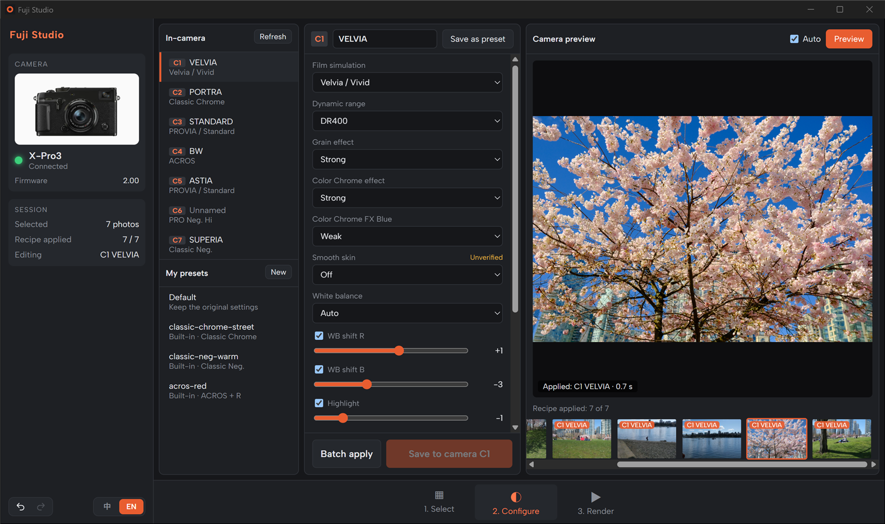
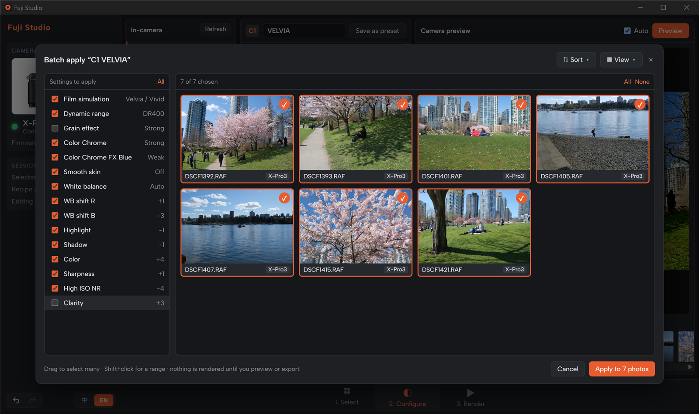
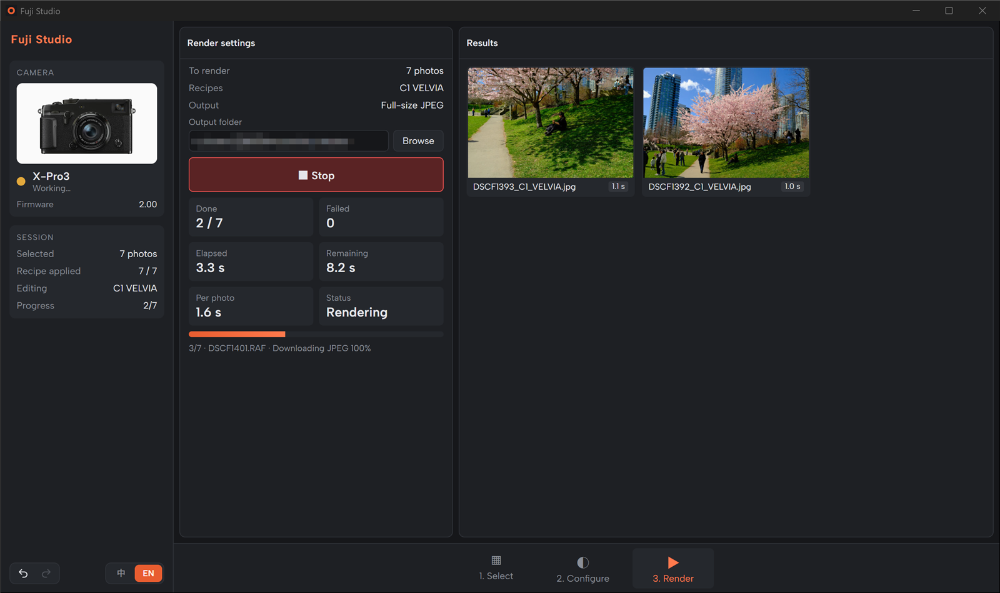

<div align="center">


# Fuji Studio

**用相机自己的引擎，快速转换富士 RAW。**

[](https://github.com/ELjagi623/fuji-studio/releases)


[功能](#功能) · [快速开始](#快速开始) · [使用方法](#使用方法) · [从源码构建](#从源码构建) · [English](README.md)



</div>

Fuji Studio 通过 USB 把 RAF 发给富士相机，由相机自己的处理器套用胶片模拟和配方，再把 JPEG 直接传回电脑。出图效果和相机机内转换完全一样，全尺寸**每张约 1 秒**，是 X RAW Studio 的快速替代品。

## 功能

- **本地图库**：内置文件夹树，资源管理器式的视图和排序，在缩略图上拖动即可批量选择。
- **所有配方**：内置胶片模拟、自己的预设，以及相机里的自定义设置 **C1–C7**（可直接编辑并保存回相机）。
- **批量应用**：把配方（或其中几项设置）应用到选中的照片，同一批照片可以混用多个配方。
- **相机实时预览**：调参数时直接看到相机的真实渲染效果，按住图片可对比原片。
- **批量渲染**：全尺寸 JPEG，显示进度、已用和剩余时间，每完成一张立即显示。
- **贴心细节**：相机 USB 模式不对时会引导设置，支持撤销/重做（<kbd>Ctrl</kbd>+<kbd>Z</kbd>），中英文界面一键切换。

<table>
  <tr>
    <td></td>
    <td></td>
  </tr>
  <tr>
    <td align="center"><em>把配方批量应用到选中的照片</em></td>
    <td align="center"><em>相机渲染中</em></td>
  </tr>
</table>

## 快速开始

### 1. 安装

从 [Releases](https://github.com/ELjagi623/fuji-studio/releases) 下载最新版本：

- `FujiStudio_x.y.z_x64-setup.exe`：安装版
- `FujiStudio_x.y.z_x64_portable.exe`：免安装单文件版

需要 Windows 10/11（64 位）。Windows 11 自带 WebView2 运行库，缺少时会自动安装。

### 2. 设置相机

1. 拔下 USB 线。
2. 在相机上打开 **MENU → 设置 → 连接设置 → PC 连接模式**。
3. 选择 **USB RAW 转换/备份恢复**。
4. 重新插上 USB 线，侧栏变绿即表示可以使用。

> [!IMPORTANT]
> 相机只能转换**同一型号**拍摄的 RAF，其他机型的照片会被标出并跳过。

> [!TIP]
> 如果相机模式不对，Fuji Studio 会自动弹出上述步骤，点一下就能重新检测。

## 使用方法

1. **选择**：在左侧选择文件夹，然后选照片（单击、拖动或 <kbd>Shift</kbd>+单击），可以跨文件夹累加。
2. **配置**：选一个配方（机内 C1–C7、内置或自己的预设），对照实时预览调整，再点 **批量应用** 把配方分配给照片。只有应用了配方的照片才会渲染。
3. **渲染**：选择输出文件夹，点 **开始渲染**。

> [!NOTE]
> 保存到相机 C1–C7 前会先请你确认，并且每次打开软件后第一次写入前，会自动备份全部 7 个槽位。

## 支持的相机

在 **X-Pro3**（固件 2.00）上开发和测试。富士 [X RAW STUDIO 兼容列表](https://www.fujifilm-x.com/support/compatibility/software/x-raw-studio/)里的机型（X-H2S、X-T5、X-S20、X100VI、GFX100 II 等）使用同一套协议，理论上可用，但尚未测试。

## 从源码构建

需要 [Rust](https://rustup.rs/)、[Node.js](https://nodejs.org/) 20+，以及 Windows 上的 [Tauri 依赖](https://tauri.app/start/prerequisites/)。

```bash
git clone https://github.com/ELjagi623/fuji-studio.git
cd fuji-studio/app
npm install
npm run fetch-cameras   # 可选：下载侧栏用的官方相机图片
npx tauri dev           # 开发模式运行
npx tauri build         # 打包安装程序
```

仓库里还有命令行工具 `fujictl`，用来测试相机协议（`cargo run -p fujictl -- --help`）。

<details>
<summary><strong>工作原理</strong></summary>

Fuji Studio 通过 Windows 便携设备（WPD）和相机进行 PTP 通信，无需更换驱动。每张照片的流程：

1. 用富士私有指令（`0x900C` / `0x900D`）上传 RAF
2. 读取转换参数（`0xD185`），只修改配方里改动的项，再写回
3. 触发转换（`0xD183`），等待新文件出现，下载 JPEG 后从相机删除

整个过程不会写入存储卡。

</details>

## 免责声明

Fuji Studio 是独立项目，与富士胶片公司无关，也未获其认可。相机产品图片版权归 FUJIFILM 所有。使用风险自负。
